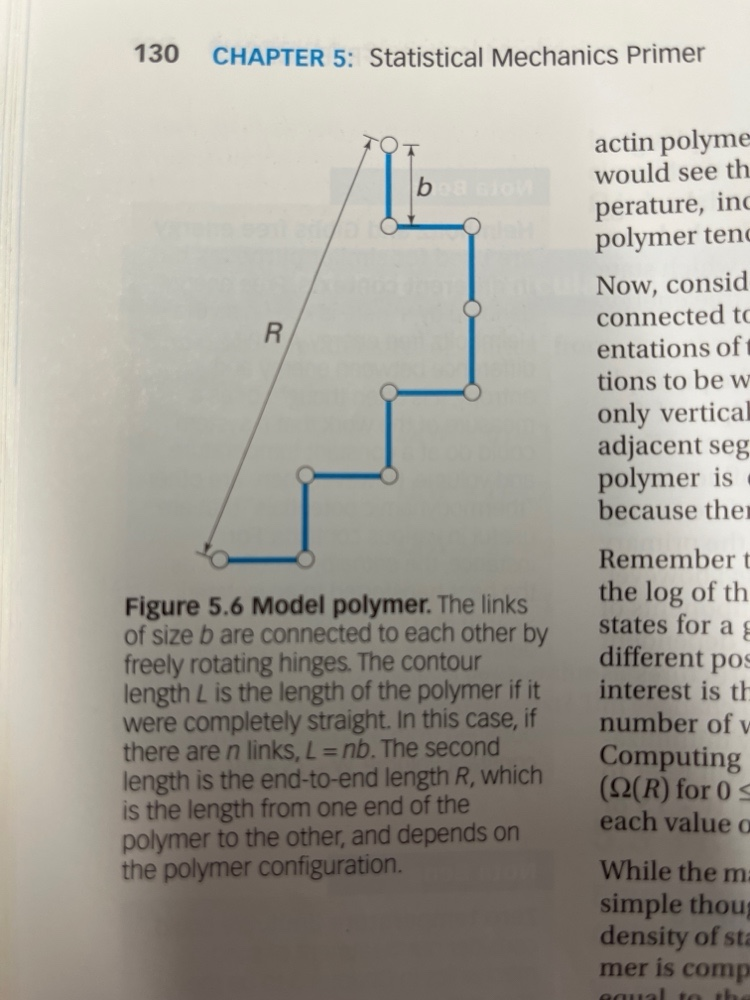

# Polymer Statistical Mechanics & Conformation Simulator
**Interactive Polymer Configurations, Density of States $\Omega(R)$, Boltzmann Entropy, and End-to-End Length $R$**  
*Based on Figure 5.6 ("Model polymer") in Christopher R. Jacobs, Hayden Huang, and Ronald Y. Kwon, Introduction to Cell Mechanics and Mechanobiology (Chapter 5: Statistical Mechanics Primer).*

🌐 **Live Web Application**: [https://ltuebl.github.io/PolymerStatisticalMechanics/](https://ltuebl.github.io/PolymerStatisticalMechanics/)

---

## Pedagogical Overview

In cellular mechanobiology, biopolymers such as actin filaments, microtubules, intermediate filaments, titin, spectrin, and DNA exhibit behavior governed by statistical mechanics and thermal fluctuations ($k_B T$).

This interactive simulation website allows students to visualize and quantitatively explore the fundamental example from **Jacobs, Huang, and Kwon (Chapter 5, Figure 5.6)**:

<p align="center">
  
</p>

> **Figure 5.6 Model polymer:** *"The links of size $b$ are connected to each other by freely rotating hinges. The contour length $L$ is the length of the polymer if it were completely straight. In this case, if there are $n$ links, $L = nb$. The second length is the end-to-end length $R$, which is the length from one end of the polymer to the other, and depends on the polymer configuration."*

---

## Key Biophysical & Mechanical Concepts

### 1. Contour Length ($L$) vs. End-to-End Distance ($R$)
* **Contour Length ($L = nb$):** The fixed physical length of the fully stretched polymer consisting of $n$ links of Kuhn/monomer length $b$.
* **End-to-End Vector ($\vec{R}$):** The vector distance from the origin $(0,0)$ to the final hinge:
  $$\vec{R} = \vec{r}_n - \vec{r}_0 = \sum_{i=1}^n \vec{s}_i = (X, Y)$$
* **End-to-End Length ($R$):** The scalar straight-line Euclidean distance:
  $$R = |\vec{R}| = \sqrt{X^2 + Y^2} \quad (0 \le R \le L)$$

### 2. Microstates vs. Macrostates
* **Microstate:** A specific, microscopic sequence of link orientations (e.g., $[\rightarrow, \uparrow, \rightarrow, \uparrow, \rightarrow, \uparrow, \uparrow, \leftarrow, \uparrow]$). For an unrestricted 2D lattice polymer of $n$ links, there are:
  $$\Omega_{total} = 4^n \quad \text{microstates}$$
* **Macrostate:** The observable macroscopic length $R$ (or coordinates $X, Y$).

### 3. Density of States $\Omega(R)$ & Boltzmann Entropy
The **density of states** $\Omega(R)$ counts how many distinct microscopic conformations produce a given end-to-end length $R$. In an isolated polymer (microcanonical ensemble):
$$P(R) = \frac{\Omega(R)}{\Omega_{total}}$$

According to Boltzmann's relation:
$$S(R) = k_B \ln \Omega(R)$$

* The fully extended state ($R = L = nb$) has only **4 microstates** (all right, all up, all left, or all down), so its entropy is minimal ($S = k_B \ln 4$).
* Moderately coiled states ($R \approx \sqrt{n}b$) possess exponentially more microstates, yielding maximum entropy.
* **The 2nd Law of Thermodynamics:** Thermal agitation spontaneously drives stretched polymers toward coiled conformations of higher entropy, generating **entropic elasticity**!

### 4. Random Walk Theorem & Root-Mean-Square Scaling
For an unrestricted ideal chain:
$$\langle R^2 \rangle = n b^2 \implies R_{rms} = \sqrt{\langle R^2 \rangle} = \sqrt{n}\,b$$

Notice that while contour length scales linearly with $n$ ($L \propto n$), the typical root-mean-square coil dimension scales only as $\sqrt{n}$.

### 5. Self-Avoiding Walks (SAW) & Excluded Volume
In real biopolymers, two monomers cannot occupy the exact same physical space ($\vec{r}_i \neq \vec{r}_j$). When **Self-Avoiding Walk (SAW)** is enabled:
* Compact, self-overlapping microstates are filtered out.
* The polymer swells due to steric repulsion, shifting the distribution toward larger $R$ with 2D Flory exponent $\nu = 3/4 = 0.75$ ($\langle R^2 \rangle \sim n^{1.5}$).

### 6. Entropic Spring Mechanics under Tensile Force
When an external force $F_x$ pulls the free end along the $x$-axis, the canonical ensemble assigns Boltzmann weights $w_i = e^{F_x X_i / k_B T}$.
At small extensions:
$$F_x \approx k_{entropic} \langle X \rangle, \quad k_{entropic} = \frac{2 k_B T}{n b^2}$$
* **Thermal Stiffening:** Unlike conventional metallic springs that soften with heat, entropic springs become **stiffer** as temperature $T$ increases!

---

## Interactive Simulator Features

### 🔬 1. Visual Chain Explorer & Interactive Builder
* **Dynamic Canvas:** Renders links in textbook cyan/blue (`#0284c7`), circular hinge nodes, origin anchor fixture, and dimension arrow for $R$.
* **Caliper Bracket ($b$):** Authentic textbook dimension bracket labeling link size $b$ on the chain.
* **Directional Step D-Pad:** Students can build any custom chain link-by-link using **[→ Right] [↑ Up] [← Left] [↓ Down]**.
* **Curated Presets:**
  1. *Jacobs Fig 5.6 Textbook Example* ($n=9$, path: R, U, R, U, R, U, U, L, U $\implies R = \sqrt{29}b \approx 5.39b$).
  2. *Fully Extended Chain* ($R = L = nb$).
  3. *Closed Hairpin Loop* ($R = 0$).
  4. *Regular Staircase* (alternating R-U steps).
  5. *Random Walk Sample*.
  6. *Self-Avoiding Walk Sample*.

### 📊 2. Exhaustive Microstate Enumerator ($n = 1$ to $8$)
* Computes all $4^n$ states (from $4$ up to $65,536$ states) in real time.
* Interactive Chart.js histogram toggling between:
  - **$\Omega(R)$ Microstates**
  - **$P(R)$ Probability**
  - **$S(R) / k_B$ Boltzmann Entropy**
* **Interactive Microstate Gallery:** Click any bar in the histogram (e.g., $R = 2b$) to inspect a paginated visual gallery of thumbnail cards showing every configuration that yields that exact length!
* Clicking any thumbnail card instantly loads that polymer configuration into the main canvas!

### 🎲 3. Monte Carlo Large-Ensemble Simulation ($n \le 300$, $N \le 30,000$)
* Simulates thousands of independent biopolymer chains.
* Live empirical histogram compared against the theoretical continuous 2D Rayleigh distribution:
  $$P(R) = \frac{2R}{n b^2} \exp\left(-\frac{R^2}{n b^2}\right)$$
* Real-time tracking of simulated $R_{rms}$ vs theoretical $\sqrt{n}b$ convergence.

### ⚡ 4. Entropic Elasticity & Tensile Force-Extension Experiment
* Apply external tensile force $F_x$ in units of $k_B T / b$.
* Adjust temperature $T$ (200 K to 400 K).
* Live Force-Extension curve displaying initial linear entropic Hookean regime and finite extensibility stiffening.

### ✍️ 5. Chapter 5 Self-Assessment Quiz
* 5 interactive practice questions directly reinforcing Chapter 5 homework and exam topics with instant feedback, scoring, and step-by-step explanations.

### 📥 6. 1-Click CSV Data Export
* Export full hinge coordinates $(x_i, y_i)$, microstates, and $\Omega(R)$ tables directly to CSV for student lab reports.

---

## Running Locally

### Option A: Standalone File (Recommended — No Server Needed)
Double-click `index_standalone.html` in any web browser (Chrome, Edge, Firefox, Safari). It is completely self-contained.

### Option B: Local Web Server
```bash
python -m http.server 8000
```
Then navigate to `http://localhost:8000/index.html`.

---

## File Structure

```
PolymerStatisticalMechanics/
├── index_standalone.html     # Self-contained offline single-file edition
├── index.html                # Modular HTML5 application
├── style.css                 # Responsive stylesheet & LTU EBL design system
├── physics.js                # Statistical mechanics, enumeration & Monte Carlo engine
├── renderer.js               # Canvas renderer for Fig 5.6 graphics & thumbnails
├── app.js                    # Application UI controller, Chart.js & quiz manager
├── bundle.mjs                # Bundler script to build standalone HTML
├── EBLlogo.png               # Lawrence Tech Experimental Biomechanics Lab logo
├── PolymerEndtoEndLengthExample.jpg # Textbook Figure 5.6 scan
├── .github/workflows/deploy.yml # GitHub Actions automated Pages deployment
└── README.md                 # Complete documentation & scientific guide
```

---

## References

1. **Christopher R. Jacobs, Hayden Huang, and Ronald Y. Kwon**, *Introduction to Cell Mechanics and Mechanobiology*, Garland Science / Taylor & Francis Group, Chapter 5: Statistical Mechanics Primer, Section "Model polymer" & Figure 5.6.
2. **Philip Nelson**, *Biological Physics: Energy, Information, Life*, W. H. Freeman.
3. **M. Rubinstein and R. H. Colby**, *Polymer Physics*, Oxford University Press.

---

&copy; 2026 Lawrence Technological University &middot; Experimental Biomechanics Laboratory (EBL) &middot; Dr. Eric G. Meyer
